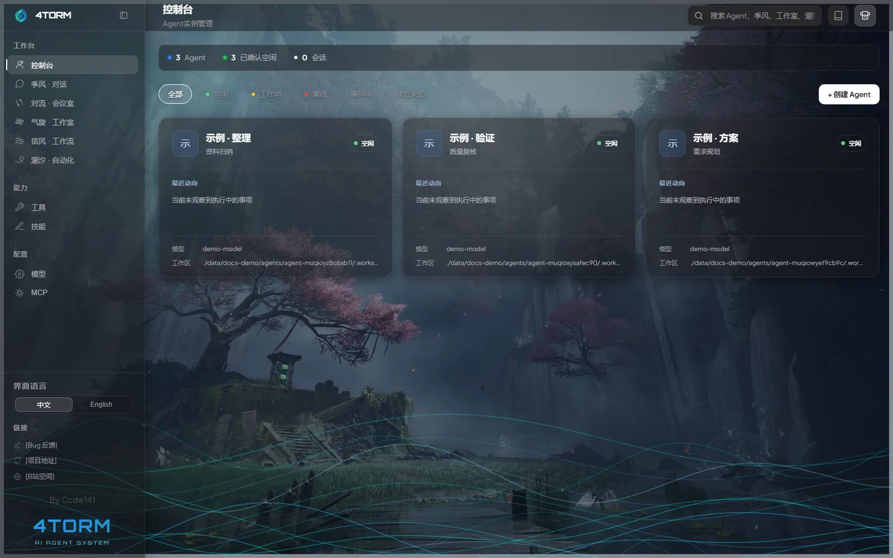

# 4torm

<p align="right"><a href="./README.md">中文</a></p>

<p align="center">
  
</p>

<p align="center">
  <strong>Keep AI agents around like long-term team members, ready to collaborate when needed</strong>
</p>

<p align="center">
  
  
  
  
</p>

4torm is a multi-agent collaboration framework. It lets you create persistent agents that can hold independent conversations, discuss problems as a team, hand work along workflows, or run tasks automatically on a schedule.

The same agent can be reused across different workspaces. Configure its model, prompt, tools, and skills once, then choose the collaboration mode that fits each task.

<p align="center">
  
</p>

## Five Workspaces

| Workspace | Manages | Best suited for |
|-----------|---------|-----------------|
| Monsoon | Conversations | Ongoing conversations with one agent, tool use, and SubAgent delegation |
| Convection | Meeting rooms | Temporary multi-agent discussions with independent advice from a meeting assistant |
| Cyclone | Workshops | Long-term collaboration between fixed seats, with private chat, group chat, synchronous contact, and asynchronous dispatch |
| Tradewind | Workflows | Visual node-based workflows that pass tasks along connected paths |
| Tide | Automated tasks | Waking agents on a schedule for recurring checks, organization, and reporting |

All five workspaces use the same agents. What changes is the form of collaboration—not the creation of another set of temporary roles.

## Tools, Skills, and MCP

4torm extends agent capabilities in three ways:

- **Tools** give agents executable operations for files, commands, networks, and other systems.
- **Skills** provide reusable expertise and working methods through `SKILL.md`.
- **MCP** connects external tool services over stdio, Streamable HTTP, and compatible SSE transports.

New agents have the framework's built-in tools and installed skills enabled by default. Custom tools and MCP tools must be selected explicitly.

Agents in Monsoon and Cyclone can also create new tools or skills at a human's request. Tool registration requires confirmation; completed skill directories are loaded automatically.

## Quick Start

### Requirements

- Node.js 20+
- npm 9+

### Install Dependencies

```bash
git clone https://github.com/ccde141/4torm.git
cd 4torm

npm install
npm --prefix server install
```

### Start

Browser development mode:

```bash
npm run dev
```

Open `http://localhost:5173`.

Desktop development mode:

```bash
npm run electron:dev
```

Production build and server:

```bash
npm run build
npm run start:prod
```

Open `http://localhost:3001`.

### First Use

1. Add a model endpoint in Provider Management.
2. Create an agent from the Console.
3. Configure its model, role prompt, tools, and skills.
4. Start a conversation in Monsoon, or organize collaboration in another workspace.

4torm uses the OpenAI Chat Completions-compatible format. Other APIs can be connected through a compatible gateway.

## Documentation

Once the app is running, open the full documentation site from **Documentation** in the top navigation bar.

| Topic | Documentation |
|-------|---------------|
| Installation and initial setup | [Quick Start](./docs/en/guide/getting-started.md) |
| Agents, sessions, and workspaces | [Core Concepts](./docs/en/guide/concepts.md) |
| Creating and configuring agents | [Agent Management](./docs/en/guide/agents.md) |
| Five workspaces | [Monsoon](./docs/en/modes/chat.md) · [Convection](./docs/en/modes/convection.md) · [Cyclone](./docs/en/modes/cyclone.md) · [Tradewind](./docs/en/modes/tradewind.md) · [Tide](./docs/en/modes/tide.md) |
| Extending agent capabilities | [Tools](./docs/en/extend/tools.md) · [Skills](./docs/en/extend/skills.md) · [MCP](./docs/en/extend/mcp.md) |
| Development and maintenance | [Architecture](./docs/en/architecture/overview.md) · [Data Layout](./docs/en/architecture/data-layout.md) · [Security Boundaries](./docs/en/architecture/security.md) |

Preview the documentation site separately:

```bash
npm run docs:dev
```

Open `http://localhost:5174`.

## Data and Permissions

Runtime data is stored under `data/`. Agents, sessions, workshops, workflows, and automated tasks each maintain their own data boundaries.

API keys, MCP configuration, and workspace runtime data are excluded from Git according to their purpose. Git exclusion is not a backup: before moving the project, separately back up any `data/` content you need to keep.

An agent's built-in file tools provide two permission levels:

- **Project**: access the 4torm project and the current workspace.
- **Unrestricted**: allow access to other paths outside the project.

Framework state is still managed through dedicated entry points, preventing agents from bypassing feature tools to rewrite tasks, workflows, or other control data directly.

## Technology Stack

- React 19, TypeScript, and Vite
- Fastify 5
- Electron
- XY Flow
- Server-Sent Events
- Model Context Protocol

## License

[MIT](./LICENSE) © Ccde141

## Links

- [GitHub Issues](https://github.com/ccde141/4torm/issues)
- [Bilibili](https://space.bilibili.com/406091025)
