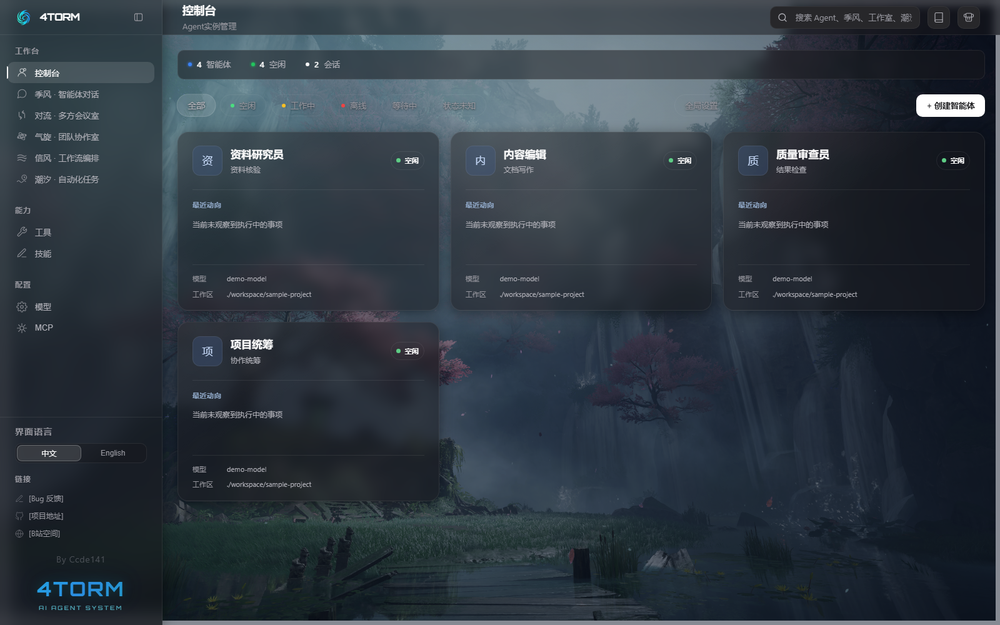

# 4torm

<p align="right"><a href="./README.md">English</a></p>

<p align="center">
  
</p>

<p align="center">
  <strong>让 AI 像公司员工一样长期存在，按需协作</strong>
</p>

<p align="center">
  
  
  
  
</p>

4torm 是一个多 Agent 协作框架，可以创建多个长期保留的 Agent，让它们独立对话、组队讨论、按工作流接力，或按照时间表自动执行任务

同一个 Agent 可以在不同功能区中复用。模型、提示词、工具和技能只需配置一次，之后根据任务选择合适的协作方式

<p align="center">
  
</p>

## 五个功能区

| 功能区 | 管理对象 | 适合处理 |
|--------|----------|----------|
| 季风 | 对话 | 与单个 Agent 持续交流、调用工具或委托 SubAgent |
| 对流 | 会议室 | 让多个 Agent 临时讨论，由会议助理提供独立私聊建议 |
| 气旋 | 工作室 | 为长期项目组织固定工位，查看工作概况，积累工位记忆并协作 |
| 信风 | 工作流 | 按严格依赖推进，或根据结果选择交接与返工路线 |
| 潮汐 | 自动化任务 | 按照设定时间唤醒 Agent，持续执行巡检、整理和汇报 |

五种功能区使用的是同一套 Agent。变化的是协作方式，不是重新创建一批临时角色

在季风中交代目标后，Agent 可以调用已启用的框架协作工具，自主创建会议或工作室、搭建并启动工作流、安排定时任务，并跟进执行结果。你也可以进入对应功能区，查看进度和记录，或直接参与协作。

## 工具、技能与 MCP

4torm 通过三种方式扩展 Agent 能力：

- **工具**：为 Agent 提供文件、命令、网络或其他可执行操作
- **技能**：通过 `SKILL.md` 提供可复用的专业知识与工作方法
- **MCP**：连接 stdio、Streamable HTTP 和兼容 SSE 的外部工具服务

新建 Agent 默认启用框架内置工具和已经安装的技能，自定义工具与 MCP 工具需要明确选择

季风和气旋中的 Agent 还可以根据人类要求创建新的工具或技能，工具注册需要确认，技能目录完成后会自动载入

## 快速开始

### 环境要求

- Node.js 20.19+（20.x）或 22.12+
- npm 9+

### 安装依赖

```bash
git clone https://github.com/ccde141/4torm.git
cd 4torm

npm install
npm --prefix server install
```

Windows PowerShell 如禁止执行 `npm.ps1`，可将命令中的 `npm` 改为 `npm.cmd`。

### 启动

浏览器开发模式：

```bash
npm run dev
```

打开 `http://localhost:5173`

桌面开发模式：

```bash
npm run electron:dev
```

生产构建与运行：

```bash
npm run build
npm run start:prod
```

打开 `https://localhost:3001`

构建完成后，也可以运行 `npm run electron:prod` 打开桌面窗口。

Linux 桌面使用见 [Linux 桌面版](./LINUX.md)。需要把后端部署在 Linux 或 Docker，再从其他设备连接时，见[独立后端与远程客户端](./REMOTE.md)。

### 首次使用

1. 在提供商管理中添加服务，选择真实提供商类型并启用一个或多个模型
2. 进入控制台创建 Agent
3. 配置模型、角色提示词、工具和技能
4. 从季风开始一段对话，或进入其他功能区组织协作

内置预设覆盖通用 OpenAI 兼容接口、云端提供商专属配置，以及 llama.cpp、LM Studio、Ollama 和 vLLM 等本地推理框架。提供商专属参数默认收起，需要时再调整

## 文档

应用启动后，可以从顶部的「使用文档」进入完整文档站

| 内容 | 文档 |
|------|------|
| 首次配置 | [快速开始](./docs/guide/getting-started.md) |
| Agent、会话与工作区 | [核心概念](./docs/guide/concepts.md) |
| Agent 创建与配置 | [Agent 管理](./docs/guide/agents.md) |
| 五种功能区 | [季风](./docs/modes/chat.md) · [对流](./docs/modes/convection.md) · [气旋](./docs/modes/cyclone.md) · [信风](./docs/modes/tradewind.md) · [潮汐](./docs/modes/tide.md) |
| 扩展 Agent 能力 | [工具](./docs/extend/tools.md) · [技能](./docs/extend/skills.md) · [MCP](./docs/extend/mcp.md) |
| 开发与维护 | [总体架构](./docs/architecture/overview.md) · [数据目录](./docs/architecture/data-layout.md) · [安全边界](./docs/architecture/security.md) |

单独预览文档站：

```bash
npm run docs:dev
```

打开 `http://localhost:5174`

## 技术栈

- React 19、TypeScript、Vite
- Fastify 5
- Electron
- XY Flow
- Server-Sent Events
- Model Context Protocol

## 许可证

[MIT](./LICENSE) © Ccde141

## 链接

- [GitHub Issues](https://github.com/ccde141/4torm/issues)
- [Bilibili](https://space.bilibili.com/406091025)
